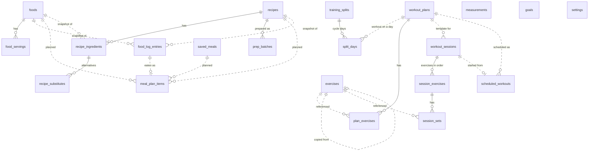

# RepForge data model (schema v7)

Source of truth: `app/lib/data/db/tables.dart` (drift tables) and `app/lib/domain/**` (entities). Snapshots: `app/drift_schemas/drift_schema_v{n}.json`; migration tests: `app/test/data/migration_test.dart`.

## Principles
- Local-first SQLite (ADR-0004). Every user-record table carries `id` (UUID v4), `created_at`, `updated_at`, `deleted_at` (soft delete) so a sync layer can be added without a rewrite.
- Dates are stored as ISO-8601 text (drift `store_date_time_values_as_text`): a UTC `DateTime` is stored with a `Z` suffix, a local `DateTime` with its offset (`+01:00`). Values read back as the same instant. Reconciled 2026-11-04 (WP 3 acceptance): the earlier wording "UTC text" was inaccurate; the stored data is retained as is, and no existing rows are rewritten. Sync ordering (WP 12) must compare instants, not strings. Enums are stored by name.
- Units are explicit: nutrients per 100 g or per 100 ml (`per100_unit`), quantities as `amount` + `unit`, loads in kg (0.25 kg steps), body weight in kg (0.1), lengths in cm (0.1).
- Nutrition logged to the diary is a **snapshot** (NUT-010): editing a food later never rewrites history.
- **Unknown is not zero** (D1, NUT-007/NUT-021): protein, carbs, fat and fibre are nullable everywhere (domain `NutrientAmounts` and the columns of `foods`, `food_log_entries`, `saved_meal_items`, `recipe_ingredients`, `recipes`). `null` means the source did not state the value; it is never stored or computed as 0. Only energy (`kcal`) is always required. Scaling keeps null as null; adding or summing gives the sum of the KNOWN values and null only when no input knows the value. `NutrientTotals` carries that sum (`known`) plus, per nutrient, how many inputs were unknown, so summaries can say "80 g, 1 entry unknown" instead of presenting a partial sum as complete. A recipe's computed per-portion value for a nutrient is null when any ingredient lacks it.
- Provenance (`verified` / `userEntered` / `estimated`) travels with every nutrient value.

## Entity relationship diagram

Solid lines are foreign keys with cascade delete; dotted lines are loose references by id (the referenced row may be deleted or edited without affecting history).

## Tables

| Table | Purpose | Notable columns |
|---|---|---|
| `measurements` | One reading of one body site (weight or 12 circumference sites, left/right separate) | `site`, `value` (kg or cm), `recorded_at`, `note` |
| `foods` | Food database | `per100_unit`, `kcal`, `protein_g?`, `carbs_g?`, `fat_g?`, `fibre_g?`, `provenance`, `source`, `barcode?`, `search_key` (lower-cased, diacritic-stripped) |
| `food_servings` | Named servings of a food | `label`, `amount`, `unit`, `sort_order` |
| `food_log_entries` | Diary entries with nutrient snapshot (macros nullable) | `day` (YYYY-MM-DD local), `meal`, `amount`, `unit`, nutrient columns, `provenance`, `logged_at`, `food_id?`, `recipe_id?` |
| `saved_meals` / `saved_meal_items` | Named sets of logged items re-logged in one action; item nutrients (macros nullable) are the snapshot for the stored amount, not per 100 | `name`, `default_meal?`; items: `amount`, `unit`, nutrient columns, `provenance`, `sort_order` |
| `recipes` | Recipes | `portions` (real, may be fractional), prep/cook minutes, storage, `freezing` (`yes`/`no`/`unknown`, default `unknown`), reheating, `favourite`, `prep_steps_json`, `cook_steps_json`, `total_weight_g?`, `portion_weight_g?`, `ingredient_notes_json` (imported recipes only), declared per-portion nutrients (nullable), `nutrition_note` |
| `recipe_ingredients` | Ingredient lines with optional per-100 nutrient snapshot in the line's unit | `amount`, `unit` (canonical g or ml), `sort_order`, `food_id?`, `serving_label?`, `serving_count?` (display only), nutrient columns?, `provenance?` |
| `recipe_substitutes` | Alternative foods for an ingredient (RCP-010); deleted with the ingredient | `recipe_ingredient_id`, `sort_order`, `name`, `food_id?`, `amount`, `unit`, per-100 nutrients of `unit`, `provenance` |
| `meal_plan_items` | Planned recipe, food or saved meal on a day and meal (RCP-014). Created in v5, used from WP 7 stage 3 | `day` (YYYY-MM-DD), `meal`, `kind` (`recipe`/`food`/`savedMeal`), `ref_id`, `name`, `amount`, `unit` (`grams`/`millilitres`/`portions`), `eaten_entry_id?` (one or more diary entry ids, comma-separated), `sort_order`; index on `day` |
| `prep_batches` | Meal-prep batches of a recipe (RCP-015). Created in v5, used from WP 7 stage 3 | `recipe_id`, `prepared_at`, `portions_made`, `portions_remaining` (CHECK ≥ 0) |
| `exercises` | Exercise library (TRN-008..012) | `type` (weighted/bodyweight/assisted/timed/distance/cardio), `category`, `primary_muscle`, `secondary_muscles_json`, `equipment_json` (identifiers from `docs/training-taxonomy.md`), `aliases_json`, `search_key` (normalised name and aliases), `supplied` (bundled library entry; replaces `is_custom`, supplied = NOT is_custom), `copied_from_id?` (custom copy of a supplied exercise), `archived` |
| `workout_plans` | Templates | `split?` (legacy free-text label), `scheduled_weekdays_json`, `archived` |
| `plan_exercises` | Planned exercises with targets (TRN-013). CHECKs: sets 1–20, reps 1–100 as a range (`reps_min`, `reps_max` both set or both null, min ≤ max), load 0–1000 kg, duration > 0, metres > 0, rest 0–3600 s | `target_sets`, `reps_min?`, `reps_max?`, `target_load_kg?`, `target_duration_sec?`, `target_metres?`, `rest_seconds?` |
| `training_splits` | Named repeating workout cycle (TRN-014); CHECK `cycle_days` 1–14 | `name`, `cycle_days`, `sort_order` |
| `split_days` | One day of a split's cycle; deleted with the split; `plan_id` null = rest day; unique (`split_id`, `day_index`) | `split_id`, `day_index` (0–13), `plan_id?` |
| `workout_sessions` | Performed workouts. `deleted_at` is the TRN-024 delete: a soft delete that `RestoreSession` undoes at any time (nothing is purged); deleted sessions are left out of history, records and volume | `plan_id?`, `started_at`, `ended_at?`, `notes` (session note, at most 4000 characters, TRN-023) |
| `session_exercises` | The exercises of a session in order (v7, TRN-017/023). An entry exists before any set does. A session may hold the same exercise in several entries (WP 9 review F1); a set is recorded against an entry id (`RecordSet`), and `AddSessionExercise` / `ReplaceSessionExercise` accept an exercise already present (replace refuses the entry's own exercise). Deleted with the session. CHECKs: `position` ≥ 0, `note` at most 4000 characters | `session_id`, `position` (authoritative order, 0..n-1), `exercise_id` (loose reference), `note?` |
| `scheduled_workouts` | A workout plan placed on a local date (v7, TRN-015). Dated rows, so moving or skipping never changes the plan. `day` and `source_day` are local dates as `YYYY-MM-DD` (like `food_log_entries.day`); `source_day` never changes and is how regeneration tells a moved or skipped occurrence from a missing one. `plan_id` and `session_id` are loose references. CHECKs: `origin` in (`date`, `weekday`, `split`), `status` in (`planned`, `skipped`, `done`) | `day`, `source_day`, `plan_id`, `origin`, `status`, `session_id?` (set when started from it; cleared when that session is deleted, which also sets the status back from `done` to `planned`, and set again when the session is restored while the occurrence is still planned on the session's start date) |
| `session_sets` | Sets, written only by `WorkoutSessionRepository.addSet` (the path `RecordSet` validates and uses) and changed only by `updateSet` / `deleteSet` (the `EditSet` / `DeleteSet` use cases, which validate like `RecordSet`); `WorkoutSessionRepository.upsert` writes the session row only and ignores `session.sets`, so an unvalidated set cannot be stored through it. Restore and migrations insert raw SQL rows by design. `type` selects which nullable columns apply. CHECKs (TD-25): reps 1–100, loads 0–1000 kg, duration > 0, metres > 0, heart rate 30–250, energy ≥ 0 with `energy_provenance` in (`userEntered`, `estimated`) and both set or both null, exertion 0–10, rest 0–3600 s | `load_kg?` (lifted load; added load for bodyweight and timed sets, the type column makes it unambiguous), `reps?`, `assistance_kg?`, `duration_sec?`, `metres?`, `average_heart_rate?`, `energy_kcal?`, `energy_provenance?` (cardio energy, never read by nutrition), `completed`, `exertion_scale?`, `exertion_value?`, `rest_seconds?`, `set_kind` (v7: `warmUp` / `working` / `failure`, default and migrated value `working`, CHECK), `session_exercise_id?` (v7: the entry the set belongs to; cascade; null only on rows written before v7 until the migration or restore backfills them), `note?` |
| `legacy_quarantine` | Original contents of training rows that broke a v6 CHECK when migrated or restored from an older backup (see Migrations 5 → 6) | `source_table`, `row_id`, `reason`, `original_json`, `quarantined_at` |
| `goals` | Targets | `kind`, `site?`, `target`, `start_date`, `end_date?`, `active` |
| `settings` | Key/value. Besides the app settings: `mealLabels` (JSON: slot labels and order, NUT-011), `seedRecipesVersion` (starter recipes already imported) and `seedExercisesVersion` (exercise library already imported) | `key`, `value`, `updated_at` |

## Domain rules with tests
- Nutrition: `NutrientProfile.forQuantity` (per-100 × quantity ÷ 100; unit mismatch is a validation error), `NutrientAmounts` sum/scale with null semantics for every nutrient, `NutrientTotals` (known sum plus unknown counts), `validateNutrientsPer100` (macros may be null; non-negative, ≤100 g per macro, ≤900 kcal when present), `dayKey`.
- Recipes (spec §7.5, §8, §9): per-portion nutrition is computed when every ingredient has a snapshot, otherwise the declared estimate is used and labelled `estimated`; a computed recipe carries the weakest ingredient provenance; `perPortion` is the diary snapshot (a nutrient any ingredient lacks is null) and `perPortionTotals` the view (partial sum plus unknown count); portions by weight W ÷ w; scaling is a view (`scaledBy`, `scaleToPortions`, `scaleToWeight`); `nutritionForPortions` / `nutritionForWeight`; `withSubstitution` and `kcalPerPortionDelta`; `validateRecipe` (RCP-001, 002, 004, 008).
- Meal labels (NUT-011): `MealLabels` (four unique 1–30 character labels, order a permutation of the slots); diary entries store the slot key, so a rename relabels existing entries.
- Logging a recipe (RCP-012): a diary quantity may be in `portions` (`ReferenceUnit.portions`, a count, never a food or ingredient unit) or grams; the entry keeps the recipe name, the nutrient snapshot and `recipe_id`.
- Training taxonomy (WP 8): enums `ExerciseCategory` (7), `MuscleGroup` (19), `Equipment` (21), stored by name. `Exercise.supplied` is the single provenance flag (`isCustom` is its negation, not stored). `parseDuration` (`mm:ss`, `h:mm:ss`, seconds), `formatDistance` (m below 1000, km with one decimal from 1000, stored metres unchanged), `normaliseExerciseSearch`, `validateExercise`, `validateSetForExercise` (type must match; reps 1–100; loads are `LoadKg` values, which can only be built in 0.25 kg steps, 0–1000 (`LoadKg.of` rejects anything else); durations and metres > 0, whole seconds and 0.1 m; heart rate 30–250; energy ≥ 0 with a user-entered or estimated label; exertion per scale), `validatePlanExercise`, `validateSplit`, `reorder`/`reorderPlanExercises`, library filters (`ExerciseQuery`: text over name and aliases, category, muscle with primary matches first, available equipment as a subset test with bodyweight always shown, archived hidden by default). Cardio energy is a training record only: no nutrition code reads it (TRN-007(2)).
- Training: `volumeKg` (load×reps for weighted; added load×reps for bodyweight; others 0), `estimatedOneRepMax` (Epley, 1–12 reps, 1 rep = load), `maxLoadFor`, `isPersonalRecord` per type (ties are not records), `validReps` (1–100), `validExertion` (D04 TRN-020: RPE 1–10 in steps of 0.5, RIR 0–5 in whole numbers; the v6 CHECK is looser, 0–10, and stays so because domain rules may be stricter than the CHECKs).
- Set kind (WP 9, TRN-019): `SetKind` warm-up / working / failure stored per set; `RecordSet` and `EditSet` take it (default working). Warm-up sets and sets not completed are excluded from volume and personal records; working and failure count.
- Session exercises (WP 9, TRN-017/023): a session has ordered entries (`session_exercises`); `position` is authoritative and `session_sets.exercise_order` mirrors it (rewritten by `setExerciseOrder`; never rewritten by the migration). `RecordSet` records against a given entry (`sessionExerciseId`) and validates the set against that entry's exercise; a session may hold the same exercise in several entries (WP 9 review F1). `ReplaceSessionExercise`: a set recorded stays with the original exercise; with sets the original entry stays and the new exercise gets a new empty entry directly after it, without sets the entry itself changes exercise (note and position kept). `RemoveSessionExercise` removes the entry and its sets (the caller confirms). Notes: session and exercise notes are trimmed, at most 4000 characters (TRN-023 asks for at least 2000), blank clears.
- Personal records (WP 9, TRN-026, `personal_records.dart`, pure and derived, never stored): weighted = heaviest load at each exact rep count 1–12; timed = longest duration; distance = longest distance; bodyweight = most repetitions. **Assumptions**: an added load on a bodyweight or timed set is ignored for its record (D04 says "most repetitions" and "longest duration" only); assisted and cardio have no record because D04 defines none (recorded as a gap, nothing invented). A set is a PR when it strictly beats every earlier set in its slot (the first set in a slot is a PR; ties are not), earlier meaning session start, then session creation time, then session id, exercise order, set order (review F7). Because records are recomputed from the history on every read, editing or deleting a set (or deleting a session) changes them with no bookkeeping. The older `TrainingRules.isPersonalRecord` (Epley score, assisted and cardio rules) is not used by the app and is superseded by these rules.
- Volume (WP 9, TRN-027, `volume.dart`, pure and derived): weighted completed working and failure sets give load × reps in kg (80 × 5 + 80 × 4 = 720); bodyweight and assisted sets report repetitions, timed sets seconds, distance sets metres, cardio sets seconds and metres; an added load is not volume (differs from the older `TrainingRules.volumeKg`, which is not used by the app). Per exercise, per session, per week and per muscle group: a set's exercise adds to its primary muscle in full and, kept in a separate `secondary` total, to each secondary muscle (never added together). A session counts in the week of its start; the day is attributed with `dayStartHour` through the nutrition `diaryDayKey`, and the week starts on `weekStartDay` (default Monday).
- Scheduling (WP 9, TRN-015): `ScheduledWorkout` rows. `ScheduleWeekdays` and `ScheduleSplitCycle` generate the next 8 weeks from a start date (cycle day 0 on the start date; rest days produce nothing). Duplicate rule: an occurrence is identified by (plan, `source_day`, origin); generating again creates no occurrence whose identity exists (a moved or skipped one is not brought back) and no second occurrence of a plan on a date where it already has a planned or done one. Only a planned occurrence can be moved or skipped; neither touches the plan. Starting a session from a plan with a scheduled workout marks it done and links `session_id` in one transaction. Deleting that session puts the occurrence back to planned and keeps the session id on it as the released link; restoring the session re-links only that occurrence, and only while it is still planned and still carries that id (review F10, N1, N2). A skipped occurrence can be restored to planned (`UnskipScheduledWorkout`) unless the date is taken.
- Rest timer (WP 9, TRN-021, `rest_timer.dart`): immutable `RestTimer` with a wall-clock end time; `start` (planned rest 0–3600 s, else the default setting), `pause` (keeps the time left), `resume`, `extend` (15 s steps, at most 3600 s left; a timer already at zero restarts with 15 s), `skip`, `remaining(now)`, `isDone(now)`. Settings: `defaultRestSeconds` (default 90, 0–3600) and `restTimerNotifications` (default off, PLT-007 opt-in); no existing setting default changed.
- Units: `Quantity` (≥0, 0.1 steps), `Kilograms` (20–500, 0.1), `Centimetres` (10–300, 0.1), `LoadKg` (0–1000, 0.25; `LoadKg.of` is the one input constructor and rejects off-step or negative values, `fromStored`/`tryFromStored` read stored rows and snap to the step), display conversions kg↔lb, cm↔in, g↔oz, ml↔fl oz.

## Migrations
| From → to | What happens | Test |
|---|---|---|
| 6 → 7 | WP 9, **additive only**, one transaction (no table is rebuilt for it; foreign keys are off during `onUpgrade` as for every step, and on again from `beforeOpen`): `session_sets` gets `set_kind` (`NOT NULL DEFAULT 'working'` with a CHECK, so every existing set becomes `working`) and `session_exercise_id` (nullable, references `session_exercises`, cascade); `session_exercises` and `scheduled_workouts` are created with indexes. Every set without an entry then gets one (`AppDatabase.backfillSessionExercises`): sets are grouped by (session, `exercise_order`, exercise); each group gets its own new entry `legacy:<session>:<position>` at the next free position, groups taken in `exercise_order` then first-row order, so two exercises that shared an `exercise_order` get distinct positions and the same exercise at two orders (A@0, B@1, A@2) becomes three entries in that order; groups are never merged. **No existing value is rewritten**: `exercise_order` and every other set column stay as stored; sessions (soft-deleted ones included) and plans are untouched. Idempotent: columns, tables and indexes are created only if missing and the backfill only touches sets with no entry, so a re-run after a crash before `user_version` is written changes nothing. The v5 → v6 step lists the two new `session_sets` columns among its `newColumns` (drift copies into the current table shape; it changes no v6 behaviour). Older steps (v1 → v2 creates the current schema directly) are otherwise unchanged | `migration_v7_test.dart`: A@0, B@1, A@2 gives three entries in order; v6→v7 keeps every set value (compared column by column), kind `working`, entries created with the position rules above including two exercises sharing an order and a soft-deleted session, no scheduled rows, CHECKs enforced (set kind, origin, position, note length); v6 re-run after a crash keeps v7-only data and creates no duplicate entry; snapshot v7 present. `migration_test.dart` and `migration_v6_test.dart`: v1/v2/v3/v4/v5 → v7 validated with `SchemaVerifier` (the v1 path creates the v7 schema directly) |
| 5 → 6 | WP 8, one transaction with foreign keys off. `exercises` is rebuilt (`supplied` = NOT `is_custom`, `is_custom` dropped, new `aliases_json`, `search_key`, `copied_from_id`; free-text type/category/muscle/equipment are matched to a taxonomy identifier, its label (`docs/training-taxonomy.md`) or a short synonym table (quads, hams, lat, glute, calf, pecs, traps, rhomboids, abdominals, cables, bands, stretching and a few plurals; "delts" and "shoulders" are deliberately absent because they name three groups), ignoring case, spaces and punctuation; "none"/"bodyweight" equipment means an empty list. An unmatched optional value (secondary muscle, equipment item) is dropped from the list; an unmatched required value (type, category, primary muscle) is never invented, the exercise row is kept as it is and stays unreadable to the mappers (technical debt, see WP8 record); in both cases the original row is copied to `legacy_quarantine` with the reason. The identical mapping runs for a pre-v6 backup restore; `search_key` computed in Dart because SQLite cannot fold diacritics). `plan_exercises` is rebuilt (`target_reps` copied into `reps_min` and `reps_max`, new `target_metres`, CHECKs). `session_sets` is rebuilt (new `energy_kcal`, `energy_provenance`, CHECKs; a timed set's added load reuses `load_kg`). `training_splits`, `split_days`, `legacy_quarantine` and an index are created. **Rows that break a new CHECK (TD-25) are never clamped**: before the rebuild an out-of-range value in a nullable column is set to NULL (the domain allows "not recorded"), a plan exercise whose `target_sets` (NOT NULL) is outside 1–20 is removed from its table, and in both cases the complete original row is kept as JSON in `legacy_quarantine` with the reason. A set whose required value (reps, load, assistance, duration, metres) became NULL is unreadable to the app (the mappers skip it) but remains in the database and in backups. Before WP 8 no app code could write a set, so real data is not expected to hit this path. Idempotent: the rebuilds run only while `session_sets` has no `energy_kcal` column; tables and indexes are created if missing; a re-run after a crash before `user_version` is written changes nothing | `migration_v6_test.dart`: v5→v6 keeps an exercise (supplied and custom), a plan exercise with `target_reps`, a set of each of the six types, and the plan row (no cascade); CHECKs enforced after migration; violating v5 rows (reps 0, heart rate 300, `target_reps` 150, `target_sets` 0) are NULLed or moved with the original quarantined; v5 re-run after a crash keeps v6-only data and does not quarantine twice. `migration_test.dart`: v1/v2/v3/v4 → v6 validated with `SchemaVerifier` |
| 4 → 5 | `recipes` is rebuilt with drift `TableMigration` in one transaction with foreign keys off (dropping it with keys on would cascade-delete `recipe_ingredients`): `portions` integer → real; `method_steps_json` is copied into `cook_steps_json` (a v4 recipe has one step list, the method); `prep_steps_json` starts `[]`; `freezer_friendly` becomes `freezing` with 1 → `yes` and 0 → `unknown` (in v4 false was the default and meant "not stated", so mapping it to `no` would assert a safety claim, RCP-005/OQ-13); new `total_weight_g`, `portion_weight_g`, `ingredient_notes_json`. `recipe_ingredients` gains `serving_label`, `serving_count` (added only if absent). Creates `recipe_substitutes`, `meal_plan_items`, `prep_batches` and their indexes. Idempotent: the rebuild runs only if `cook_steps_json` does not exist yet, columns are added only if absent, tables and indexes are created if missing, so a re-run after a crash before `user_version` is written changes nothing and loses nothing | `migration_test.dart`: v4→v5 keeps a recipe with an ingredient (method → cook steps, freezer flag mapping, real portions, soft-deleted flag kept); v5 re-run after a crash keeps v5-only data; prep batch CHECK; v1/v2/v3→v5 validated with `SchemaVerifier` |
| 3 → 4 | `protein_g`, `carbs_g`, `fat_g` become nullable on `foods`, `food_log_entries`, `saved_meal_items`. SQLite cannot drop NOT NULL, so each table is rebuilt with drift `TableMigration` (create, copy all rows, drop, rename, recreate indexes) in one transaction with foreign keys off (otherwise dropping `foods` would cascade-delete `food_servings`). Existing values are copied unchanged. Re-runnable: rebuilding an already-v4 table copies the same rows, so a re-run after a crash before `user_version` is written is safe | `migration_test.dart`: v3→v4 keeps a food, serving, log entry and saved-meal item and accepts null macros afterwards; v1→v4, v2→v4; v3 re-run after a crash |
| 2 → 3 | Adds `saved_meals`, `saved_meal_items` and their index | `migration_test.dart` (v2→v3 keeps rows; v1→v3 direct) |
| 1 → 2 | Creates the full current schema and returns; copies `weight_entries` into `measurements` with `site = weight` (including soft-deleted rows); drops `weight_entries`. Idempotent: every statement is guarded, so a re-run after a crash before `user_version` is written is a no-op | `migration_test.dart`: structure validated with drift's `SchemaVerifier`; data copy asserted row by row |

Adding a version: bump `schemaVersion`, add the step in `onUpgrade`, run `dart run drift_dev schema dump lib/data/db/app_database.dart drift_schemas/drift_schema_v{n}.json` and `dart run drift_dev schema generate --data-classes --companions drift_schemas/ test/data/generated_migrations/`, then add a case to the migration test.

## Backup
`DriftBackupRepository` exports every table's raw rows as JSON (`formatVersion` 2, `schemaVersion`, `exportedAt`) and restores by replacing all data in one transaction. A file from a newer format version than 2 is refused (formats 1 and 2 are restored); a malformed file changes nothing. A file made before schema v5 has its recipes mapped to the v5 columns (method steps, freezer flag); a file made before v6 has its training rows mapped the same way as the migration (`is_custom` → `supplied`, taxonomy names, search key, `target_reps` → range) and any row that breaks a v6 CHECK is NULLed or left out with its original kept in `legacy_quarantine`. A file made before v7 has no `session_exercises` table: after the rows are restored, every set gets an entry exactly like the v6 → v7 migration (set kind `working` by the column default); a v7 file carries its entries, set kinds and scheduled workouts and is restored as it is. `formatVersion` is 2 since schema v7 (WP 9 review F10): the files now carry set kinds, session exercise entries and scheduled workouts, which an app that predates them would drop silently. Format 1 files (schema v6 and earlier) are still restored. **Protection against an older app**: the restore code of the WP 8 app (commit b1ab45a, `formatVersion` 1) refuses every file whose `formatVersion` is not an integer or is greater than 1 ("made by a newer version of RepForge"), so a WP 8 app does refuse a format 2 file and changes nothing. The check has been in the restore code since WP 3 (commit 75b6e18), so every app version from WP 3 on refuses format 2; an app without the check does not exist in the history of this repository. The refusal is by `formatVersion` only: it does not look at `schemaVersion`.

## Known limitations (tracked in D05)
- `validReps` / `validExertion` are enforced on write since WP 8: the `RecordSet` use case validates every set against its exercise (`validateSetForExercise`) and is the only set-writing path exposed to the app. The database CHECK constraints of schema v6 are the second line of defence (TD-25).
- Typed input is validated, never rounded (TRN-002(2)); reading a stored load rounds to 0.25 kg; stored quantities round to 0.1. Values are validated on write, so this only matters for rows written outside the app.
- Upserting a soft-deleted id keeps it deleted (intentional: restore is explicit).
