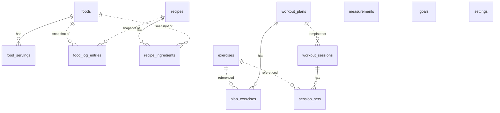

# RepForge data model (schema v4)

Source of truth: `app/lib/data/db/tables.dart` (drift tables) and `app/lib/domain/**` (entities). Snapshots: `app/drift_schemas/drift_schema_v{n}.json`; migration tests: `app/test/data/migration_test.dart`.

## Principles
- Local-first SQLite (ADR-0004). Every user-record table carries `id` (UUID v4), `created_at`, `updated_at`, `deleted_at` (soft delete) so a sync layer can be added without a rewrite.
- Dates are stored as ISO-8601 text (drift `store_date_time_values_as_text`): a UTC `DateTime` is stored with a `Z` suffix, a local `DateTime` with its offset (`+01:00`). Values read back as the same instant. Reconciled 2026-11-04 (WP 3 acceptance): the earlier wording "UTC text" was inaccurate; the stored data is retained as is, and no existing rows are rewritten. Sync ordering (WP 12) must compare instants, not strings. Enums are stored by name.
- Units are explicit: nutrients per 100 g or per 100 ml (`per100_unit`), quantities as `amount` + `unit`, loads in kg (0.25 kg steps), body weight in kg (0.1), lengths in cm (0.1).
- Nutrition logged to the diary is a **snapshot** (NUT-010): editing a food later never rewrites history.
- **Unknown is not zero** (D1, NUT-007/NUT-021): protein, carbs, fat and fibre are nullable everywhere (domain `NutrientAmounts` and the columns of `foods`, `food_log_entries`, `saved_meal_items`, `recipe_ingredients`, `recipes`). `null` means the source did not state the value; it is never stored or computed as 0. Only energy (`kcal`) is always required. Scaling keeps null as null; adding or summing gives the sum of the KNOWN values and null only when no input knows the value. `NutrientTotals` carries that sum (`known`) plus, per nutrient, how many inputs were unknown, so summaries can say "80 g, 1 entry unknown" instead of presenting a partial sum as complete. A recipe's computed per-portion value for a nutrient is null when any ingredient lacks it.
- Provenance (`verified` / `userEntered` / `estimated`) travels with every nutrient value.

## Entity relationship diagram

Solid lines are foreign keys with cascade delete; dotted lines are loose references by id (the referenced row may be deleted or edited without affecting history).

## Tables

| Table | Purpose | Notable columns |
|---|---|---|
| `measurements` | One reading of one body site (weight or 12 circumference sites, left/right separate) | `site`, `value` (kg or cm), `recorded_at`, `note` |
| `foods` | Food database | `per100_unit`, `kcal`, `protein_g?`, `carbs_g?`, `fat_g?`, `fibre_g?`, `provenance`, `source`, `barcode?`, `search_key` (lower-cased, diacritic-stripped) |
| `food_servings` | Named servings of a food | `label`, `amount`, `unit`, `sort_order` |
| `food_log_entries` | Diary entries with nutrient snapshot (macros nullable) | `day` (YYYY-MM-DD local), `meal`, `amount`, `unit`, nutrient columns, `provenance`, `logged_at`, `food_id?`, `recipe_id?` |
| `saved_meals` / `saved_meal_items` | Named sets of logged items re-logged in one action; item nutrients (macros nullable) are the snapshot for the stored amount, not per 100 | `name`, `default_meal?`; items: `amount`, `unit`, nutrient columns, `provenance`, `sort_order` |
| `recipes` | Recipes | `portions`, prep/cook minutes, storage, `freezer_friendly`, reheating, `favourite`, `method_steps_json`, declared per-portion nutrients (nullable), `nutrition_note` |
| `recipe_ingredients` | Ingredient lines with optional per-100 nutrient snapshot in the line's unit | `amount`, `unit`, `sort_order`, `food_id?`, nutrient columns?, `provenance?` |
| `exercises` | Exercise library | `type` (weighted/bodyweight/assisted/timed/distance/cardio), `category`, `primary_muscle`, `secondary_muscles_json`, `equipment_json`, `is_custom`, `archived` |
| `workout_plans` | Templates | `split?`, `scheduled_weekdays_json`, `archived` |
| `plan_exercises` | Planned exercises with targets | `target_sets`, `target_reps?`, `target_load_kg?`, `target_duration_sec?`, `rest_seconds?` |
| `workout_sessions` | Performed workouts | `plan_id?`, `started_at`, `ended_at?`, `notes` |
| `session_sets` | Sets; `type` selects which nullable columns apply | `load_kg?`, `reps?`, `assistance_kg?`, `duration_sec?`, `metres?`, `average_heart_rate?`, `completed`, `exertion_scale?`, `exertion_value?`, `rest_seconds?` |
| `goals` | Targets | `kind`, `site?`, `target`, `start_date`, `end_date?`, `active` |
| `settings` | Key/value | `key`, `value`, `updated_at` |

## Domain rules with tests
- Nutrition: `NutrientProfile.forQuantity` (per-100 × quantity ÷ 100; unit mismatch is a validation error), `NutrientAmounts` sum/scale with null semantics for every nutrient, `NutrientTotals` (known sum plus unknown counts), `validateNutrientsPer100` (macros may be null; non-negative, ≤100 g per macro, ≤900 kcal when present), `dayKey`.
- Recipes: per-portion nutrition is computed when every ingredient has a snapshot, otherwise the declared estimate is used and labelled `estimated`; a computed recipe is `estimated` if any ingredient snapshot is estimated, `verified` only if all are verified, otherwise `userEntered`; `forPortions` scales.
- Training: `volumeKg` (load×reps for weighted; added load×reps for bodyweight; others 0), `estimatedOneRepMax` (Epley, 1–12 reps, 1 rep = load), `maxLoadFor`, `isPersonalRecord` per type (ties are not records), `validReps` (1–100), `validExertion` (RPE 1–10 / RIR 0–10 in half steps).
- Units: `Quantity` (≥0, 0.1 steps), `Kilograms` (20–500, 0.1), `Centimetres` (10–300, 0.1), `LoadKg` (0–1000, 0.25), display conversions kg↔lb, cm↔in, g↔oz, ml↔fl oz.

## Migrations
| From → to | What happens | Test |
|---|---|---|
| 3 → 4 | `protein_g`, `carbs_g`, `fat_g` become nullable on `foods`, `food_log_entries`, `saved_meal_items`. SQLite cannot drop NOT NULL, so each table is rebuilt with drift `TableMigration` (create, copy all rows, drop, rename, recreate indexes) in one transaction with foreign keys off (otherwise dropping `foods` would cascade-delete `food_servings`). Existing values are copied unchanged. Re-runnable: rebuilding an already-v4 table copies the same rows, so a re-run after a crash before `user_version` is written is safe | `migration_test.dart`: v3→v4 keeps a food, serving, log entry and saved-meal item and accepts null macros afterwards; v1→v4, v2→v4; v3 re-run after a crash |
| 2 → 3 | Adds `saved_meals`, `saved_meal_items` and their index | `migration_test.dart` (v2→v3 keeps rows; v1→v3 direct) |
| 1 → 2 | Creates the full current schema and returns; copies `weight_entries` into `measurements` with `site = weight` (including soft-deleted rows); drops `weight_entries`. Idempotent: every statement is guarded, so a re-run after a crash before `user_version` is written is a no-op | `migration_test.dart`: structure validated with drift's `SchemaVerifier`; data copy asserted row by row |

Adding a version: bump `schemaVersion`, add the step in `onUpgrade`, run `dart run drift_dev schema dump lib/data/db/app_database.dart drift_schemas/drift_schema_v{n}.json` and `dart run drift_dev schema generate --data-classes --companions drift_schemas/ test/data/generated_migrations/`, then add a case to the migration test.

## Backup
`DriftBackupRepository` exports every table's raw rows as JSON (`formatVersion` 1, `schemaVersion`, `exportedAt`) and restores by replacing all data in one transaction. A file from a newer format version is refused; a malformed file changes nothing.

## Known limitations (tracked in D05)
- `validReps` (1–100) / `validExertion` (RPE 1–10, RIR 0–10, half steps) are explicit domain rules with tests (`test/domain/training_rules_test.dart`), not yet enforced on write. Owner decision 2026-11-04: deferral to WP 9 accepted on the condition that no exposed use case can persist a set until WP 9 adds the validating session-logging use case. Verified at WP 3 acceptance: no code under `lib/features` references `SessionSet` or `WorkoutSessionRepository`; the repository is reachable only from tests.
- Reading a stored load rounds to 0.25 kg; stored quantities round to 0.1. Values are validated on write, so this only matters for rows written outside the app.
- Upserting a soft-deleted id keeps it deleted (intentional: restore is explicit).
