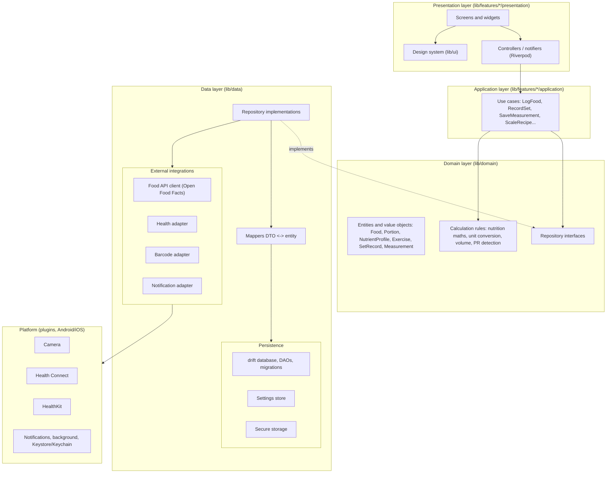

# D03 — Target Architecture Document

Status: Accepted in principle on 2026-11-01 with ADR-0002/0003/0004; package versions pinned in WP 1 (see delivery record WP1)
Date: 2026-10-31
Applies from: WP 1

## 1. Selected framework and core stack

| Concern | Choice | Rationale |
|---|---|---|
| Framework | Flutter, Dart 3, stable channel, version pinned in `pubspec.yaml` and `.fvmrc` | D02 |
| State management and DI | Riverpod (code-generated providers) | Explicit dependency graph, overridable in tests, no service locator |
| Persistence | SQLite via drift | Versioned schema, typed queries, in-memory DB for tests |
| Models | `freezed` immutable value types | Equality, copyWith, exhaustiveness |
| Navigation | go_router | Declarative, testable routes |
| Networking | `dio` behind repository interfaces | Interceptors for timeouts/retries; never used from UI |
| Charts | fl_chart wrapped in RepForge chart components | One styling entry point |
| Platform services | Plugins wrapped behind Dart interfaces in the integration layer | Swappable, mockable |
| Codegen | build_runner | drift, freezed, riverpod, json |
| Tests | flutter_test, mocktail, integration_test | Three levels |

Exact package versions are pinned during WP 1 after verifying each on both platforms. This document does not assert versions.

## 2. Layered architecture



Dependency rule: arrows point inward. Presentation depends on application and domain. Application depends on domain only. Domain depends on nothing. Data implements domain interfaces. No layer imports a plugin except the data/integration layer.

### 2.1 Presentation
- Screens are thin: they read state from Riverpod providers and dispatch intents to controllers.
- No calculations, no SQL, no HTTP, no plugin calls in widgets.
- All visual primitives come from `lib/ui` (design system): tokens, typography, spacing, `RfCard`, `RfMacroBar`, `RfTrendChart`, `RfEmptyState`, `RfErrorState`, `RfLoading`.
- Every screen has explicit empty, loading and error states.

### 2.2 Application (use cases)
- One class per user intent, e.g. `LogFoodEntry`, `ScaleRecipePortion`, `RecordWorkoutSet`, `SaveMeasurement`, `ExportBackup`.
- Use cases orchestrate repositories and domain rules, enforce validation, and return a typed `Result<T, AppError>`.
- Use cases are plain Dart and unit-tested without Flutter.

### 2.3 Domain
- Entities and value objects are immutable `freezed` types with units in the type, e.g. `Grams`, `Kilograms`, `Kilocalories`, `Millilitres`, `Centimetres`.
- `NutrientProfile` is always expressed per 100 g (or per 100 ml) plus an explicit `DataProvenance { verified, userEntered, estimated }`.
- `Portion` = quantity + unit + optional serving definition. Logged nutrition = profile × portion through one pure function with tests.
- Exercise model is polymorphic by `ExerciseType { weighted, bodyweight, assisted, timed, distance, cardio }`; a `SetRecord` carries only the fields valid for its type (sealed class).
- Measurements store each site and side individually (`MeasurementSite.thighLeft` etc.).
- Repository interfaces: `FoodRepository`, `FoodLogRepository`, `RecipeRepository`, `ExerciseRepository`, `WorkoutRepository`, `MeasurementRepository`, `GoalRepository`, `SettingsRepository`, `BackupRepository`.

### 2.4 Data
- drift database with one schema version number, migration steps per version, and schema snapshots committed under `lib/data/db/schema/` so migrations are testable (`drift_dev` schema tests).
- Repositories map rows to entities; nothing above the data layer sees a drift row.
- External clients (Open Food Facts) return DTOs, mapped to entities with provenance `verified = false` unless the source marks data as verified; crowdsourced data is labelled as such.

### 2.5 Platform-specific services (integration adapters)
Each adapter is a Dart interface with one implementation per capability and a fake for tests.

| Adapter | Android | iOS | Known limitations |
|---|---|---|---|
| `BarcodeScanner` | ML Kit via `mobile_scanner` | AVFoundation via `mobile_scanner` | Needs camera permission text in both manifests; no scanning on simulator |
| `HealthSync` | Health Connect (API 26+, HC app may be absent on older devices) | HealthKit (requires entitlement, real device) | Different data types and permission flows; write-back scoped per type; iOS simulator lacks HealthKit data |
| `Notifications` | local notifications, exact-alarm permission on 12+ | local notifications, user consent prompt | Rest timer and reminders only; no push |
| `BackgroundTasks` | WorkManager | BGTaskScheduler (opportunistic) | iOS background execution is not guaranteed; design so nothing depends on it |
| `SecureStore` | Keystore | Keychain | Used only for future sync tokens |
| `DeviceCapabilities` | reports camera, HC availability | reports camera, HK availability | UI must degrade gracefully (hide scan button rather than fail) |

## 3. Data architecture

### 3.1 Local-first
- SQLite is the system of record on the device. All routine logging works offline.
- Online calls are limited to food lookup (search/barcode) and future sync; failures degrade to manual entry with a clear message.
- A local cache table stores food products already looked up so repeat barcodes work offline.

### 3.2 Backup and export (before any cloud sync)
- JSON export/import of the full database with schema version stamp (WP 3 delivers the mechanism, WP 10 the UI).
- CSV export per domain (food log, workouts, measurements).
- Android Auto Backup and iOS iCloud backup are allowed only for the database file after the owner decides on privacy posture (see risk R-08).

### 3.3 Optional cloud sync (WP 12, deferred)
- Only if the owner wants multi-device use. Requires accounts, a backend, conflict resolution (row-level last-writer-wins with tombstones is the minimum), and a privacy policy.
- Designed now only to the extent of: every row carries `id` (UUID v4), `createdAt`, `updatedAt`, `deletedAt?` so a sync layer can be added without a schema rewrite.

### 3.4 Migrations and integrity
- Every schema change is a numbered migration with an automated test from each previous version.
- Foreign keys enabled; cascading deletes explicit; validation at use-case boundary (no negative quantities, dates in ISO-8601, units from the enum).

## 4. State management
- Riverpod providers per feature: `AsyncNotifier` for data-backed screens, `Notifier` for form state.
- Streams from drift (`watch`) feed `StreamProvider`s so UI updates on every write.
- Settings (targets, units, theme) persisted in a `settings` table, not in memory.

## 5. Module and directory layout

```
/app                      Flutter application
  /lib
    /app                  bootstrap, router, theme wiring, DI overrides
    /ui                   design system: tokens, components, charts
    /domain               entities, value objects, rules, repository interfaces
    /data                 drift db, DAOs, migrations, repositories, external clients, adapters
    /features
      /dashboard
      /nutrition
      /recipes
      /training
      /measurements
      /goals
      /settings
        /application      use cases
        /presentation     screens, widgets, controllers
  /test                   unit + widget tests, mirrors lib/
  /integration_test       on-device flows
  /android, /ios          generated platform hosts (committed)
/docs                     ADRs, deliverables, standards
/legacy/android           read-only Kotlin prototype (reference only)
/.github/workflows        CI
```

## 6. Testing strategy

| Level | Target | Runs on | Gate |
|---|---|---|---|
| Unit | domain rules, use cases, mappers, migrations (drift in-memory) | Linux CI, every push | 100% of domain rules covered by example-based tests; coverage threshold set in WP 1 |
| Widget | each screen state (empty/loading/error/data), design-system components, golden tests for tokens | Linux CI, every push | Required |
| Integration | log food, record workout, save measurement, scan (mocked adapter), export/import | Android emulator in CI; iOS simulator on macOS runner | Required on main, nightly on branches |
| Manual device | barcode scan with camera, Health Connect / HealthKit | Owner device checklist per release | Recorded in delivery record |

## 7. Security and privacy model
- No account, no network transmission of personal data until WP 12. Food lookup sends only the search term or barcode.
- Database file is in app-private storage. Encryption at rest is deferred (SQLCipher adds build complexity); decision recorded in WP 3 ADR.
- Secrets: none in repo. Food API needs no key. Future sync keys in secure storage.
- Permissions requested only on first use of the feature that needs them, with rationale text.
- Export files are user-initiated and written to a user-chosen location.
- Dependency vulnerability scanning in CI (`dart pub outdated`, `osv-scanner`).

## 8. Error handling and logging
- Use cases return `Result<T, AppError>`; `AppError` is a sealed class (validation, notFound, network, permission, storage, unexpected).
- UI maps `AppError` to user text through one function; no raw exception strings in UI.
- Logging through one `Logger` interface; debug builds print, release builds keep an in-memory ring buffer exportable from Settings for support. No third-party analytics by default.

## 9. Out of scope for the initial architecture
- Web and desktop (Flutter supports them; not configured until requested).
- AI/coaching recommendations (GOL requirements mark these as gated on data quality).
- Server backend (WP 12).
