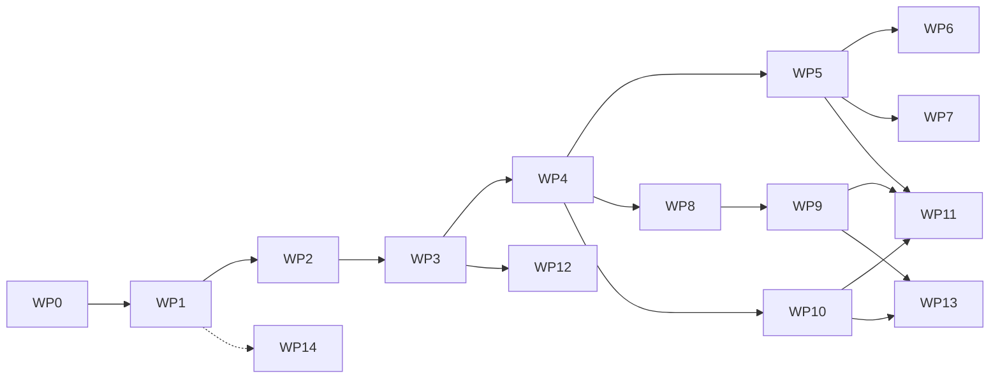

# D06 — Work Package Roadmap

Status: Proposed
Date: 2026-10-31
Sequencing principle: foundation first, then one vertical feature at a time, each verified before the next starts. Dependencies are hard unless marked (soft).

## Overview

Suggested release points: **R0 internal** after WP 6 (food logging parity with the prototype, plus persistence and tests); **R1 internal** after WP 10 (training and measurements); **R2 beta** after WP 11; **R3** after WP 12/13 if sync and health are wanted.

## Work packages

### WP 0 — Project recovery and technical baseline
- Objective: establish verified facts about the repository and decide the foundation.
- Scope: repository, CI logs, source inspection, local build evidence, framework assessment, deliverables D01–D08, ADR system, standards.
- Dependencies: none.
- Deliverables: `docs/wp0/D01…D08`, `docs/adr/`, `docs/engineering-standards.md`, `docs/delivery-record/WP0.md`.
- Acceptance: all eight documents present on the feature branch; every build-failure claim cites a run ID or log line; framework recommendation has a weighted matrix; owner has a short decision list.
- Verification: local reproduction of the CI compile failure; independent review of findings against source.
- Documentation: this set.

### WP 1 — Cross-platform framework and architecture foundation
- Objective: a Flutter application skeleton that builds for Android and iOS in CI with all quality gates, proving every architectural choice with a vertical slice.
- Scope: `flutter create` with pinned SDK; directory layout per D03 §5; Riverpod, drift, go_router, freezed wired; one `settings` table and one screen; `ci.yml` and `android.yml`; `ios.yml` simulator build; lint config; pre-commit hooks; root README; ADR-0002/0003/0004 accepted; legacy workflow set to manual.
- Dependencies: WP 0 accepted; ADR-0002 accepted.
- Deliverables: `/app` compiling on both platforms; CI green; one unit, one widget, one integration test.
- Acceptance: debug APK downloaded from CI installs and launches on an Android device; iOS simulator build succeeds on macOS runner; `format`, `analyze`, `test` pass; delivery record written.
- Verification: CI run IDs recorded; device install screenshot in delivery record.
- Documentation: README, ADRs, D03 updated with pinned versions.

### WP 2 — Application foundation and design system
- Objective: reusable UI system before any feature screens.
- Scope: design tokens (colour, typography, spacing, radii, elevation), light and dark themes, components (`RfCard`, `RfButton`, `RfTextField` with numeric/unit variants, `RfMacroBar`, `RfStatTile`, `RfTrendChart`, `RfEmptyState`, `RfErrorState`, `RfLoading`, `RfListTile`), navigation shell with bottom tabs, accessibility baseline (48 dp targets, semantics labels, text scaling), a component gallery screen (debug only), golden tests.
- Dependencies: WP 1.
- Acceptance: gallery renders every component in both themes; golden tests pass; contrast ratios meet WCAG AA for text; no feature logic in `lib/ui`.
- Verification: golden tests in CI; manual accessibility pass with TalkBack and VoiceOver recorded.
- Documentation: `docs/design-system.md`.

### WP 3 — Domain models and local persistence
- Objective: the data foundation for all features, fully tested, with backup.
- Scope: domain entities and value objects (units, nutrient profile, portion, provenance, exercise types, set records, measurement sites, goals); drift schema v1 for foods, food log, recipes, ingredients, exercises, workouts, sessions, sets, measurements, goals, settings; repositories; migration test harness; JSON backup export/import round trip; ADR on encryption-at-rest.
- Dependencies: WP 1.
- Acceptance: every calculation rule has example-based tests (portion scaling, unit conversion, volume, PR detection); export → wipe → import yields identical data; schema snapshot committed.
- Verification: unit tests on Linux CI; coverage threshold set and enforced.
- Documentation: `docs/data-model.md` with ER diagram.

### WP 4 — Navigation, dashboard and application shell
- Objective: the daily "cockpit" screen and navigation between domains.
- Scope: go_router routes, bottom navigation (Home, Food, Recipes, Train, Progress, Settings), dashboard showing today's calories/macros vs targets, next session, latest weight, workouts count; settings screen with persisted targets and units; empty states for every panel.
- Dependencies: WP 2, WP 3.
- Acceptance: dashboard reflects database changes live; targets persist across restart; widget tests for each panel state.
- Verification: widget tests; integration test "change target, restart, verify".

### WP 5 — Nutrition and food database
- Objective: fast, correct food logging.
- Scope: food search (Open Food Facts client with typed errors, debounce, caching), custom foods, custom serving sizes, portion entry in g/ml/servings, meal assignment, daily diary with edit/delete, date navigation, fibre, saved meals, provenance labels, daily and weekly summaries.
- Dependencies: WP 4.
- Acceptance: NUT requirements with priority P1 pass their acceptance criteria; logging a searched food takes ≤ 4 taps after selection; offline logging works with airplane mode.
- Verification: unit tests for nutrition maths; widget tests; integration test for log/edit/delete; manual offline test.

### WP 6 — Barcode scanning and food logging
- Objective: scan → lookup → portion → log, on both platforms.
- Scope: `BarcodeScanner` adapter with `mobile_scanner`, permission flow with rationale, capability detection, cached product table, not-found path leading to custom food creation.
- Dependencies: WP 5.
- Acceptance: scan of a known EAN logs a correctly scaled entry on Android and iOS physical devices; unavailable camera hides the scan action with explanation.
- Verification: integration test with fake adapter; manual device checklist for both platforms recorded with device models.

### WP 7 — Recipe management and meal planning
- Objective: recipes as first-class, calculable entities.
- Scope: recipe CRUD, ingredients with quantities linked to foods, per-portion nutrition computed from ingredients (not typed in), portion scaling, prep/cook/storage/freezing/reheating fields, favourites, substitutions, seed import of the 22 legacy recipes flagged `estimated`, log a portion to the diary, weekly meal plan and prep list (P2).
- Dependencies: WP 5.
- Acceptance: computed per-portion nutrition matches hand-calculated fixtures; seed recipes visible with the `estimated` label; RCP P1 criteria pass.
- Verification: unit tests for recipe maths; widget tests.

### WP 8 — Exercise library and training architecture
- Objective: structured exercise and set model supporting all six exercise types.
- Scope: exercise library (seeded, editable), categories, muscle groups, equipment, exercise type with type-specific set fields, workout plan and split models, history queries.
- Dependencies: WP 4.
- Acceptance: a set of each exercise type can be stored and read back with correct fields; invalid combinations rejected at use-case level.
- Verification: unit tests; schema migration test.

### WP 9 — Workout planning and workout execution
- Objective: fast in-gym logging.
- Scope: plan builder, scheduling, session screen with per-set weight/reps/RPE or RIR, rest timer with local notification, previous-performance hints, personal records, volume per session, notes, history.
- Dependencies: WP 8.
- Acceptance: logging a set takes ≤ 3 interactions; PRs detected per exercise and type; rest timer fires in background on Android and when app is foregrounded on iOS (documented limitation).
- Verification: unit tests for PR and volume rules; integration test for a full session; manual device test for timer.

### WP 10 — Body composition and measurement tracking
- Objective: dated measurements, trends and export.
- Scope: measurement entry (weight + 12 sites, left/right separate), date picker with validation, history with edit/delete, trend chart with axes and date range, comparisons between two dates, CSV export, export/import UI from WP 3.
- Dependencies: WP 4, WP 3.
- Acceptance: BCM P1 criteria pass; chart renders correctly for 1, 2 and 100 points; export opens in a spreadsheet.
- Verification: widget and golden tests for chart; unit tests for comparisons.

### WP 11 — Analytics and progress visualisation
- Objective: goals and weekly insight without automated coaching.
- Scope: calorie/macro/weight/measurement/training goals, weekly summary screen, progress indicators, historical comparison; explicit gate recorded that no recommendations ship until data-quality criteria (GOL) are met.
- Dependencies: WP 5, WP 9, WP 10.
- Acceptance: GOL P1 criteria pass; summaries match fixture data.

### WP 12 — User accounts, backup and synchronisation (optional)
- Objective: multi-device use if the owner wants it.
- Scope: decide backend (ADR), authentication, sync protocol with UUIDs/timestamps/tombstones, conflict policy, privacy policy, account deletion.
- Dependencies: WP 3; owner decision; privacy policy.
- Acceptance: two devices converge after offline edits on both; deletion removes server data.

### WP 13 — Health platform integrations
- Objective: weight and workouts exchanged with Health Connect and HealthKit.
- Scope: `HealthSync` adapter, permission flows, read weight, write workouts and nutrition where supported, per-platform capability table.
- Dependencies: WP 9, WP 10.
- Acceptance: documented matrix of what syncs on each platform, verified on devices.

### WP 14 — Quality assurance and release engineering (continuous from WP 1)
- Objective: release-grade confidence.
- Scope: coverage thresholds, nightly integration runs, release workflow, signing, store listings, manual device checklist, crash reporting decision (opt-in), beta distribution (Play internal testing, TestFlight).
- Acceptance: a tagged release produces signed artefacts and a changelog without manual steps beyond approval.

## Sizing guidance

Sizing is deliberately not given in days: velocity will be established in WP 1 and used to estimate WP 2 onwards. Each WP must be completable within a single short cycle; if a WP grows beyond that, split it.
