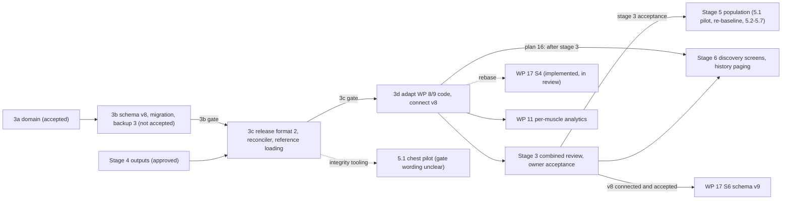

# WP 8 stages 3c, 3d, 5 and 6: specification and dependency analysis (preparation, not authorised)

- Status: **Preparation only.** Nothing in this document is implemented. Nothing in it is authorised beyond what `docs/wp8-delivery-plan.md` section 21 already authorises. It authorises no work, no sub-stage start, and no schema change.
- Date: 2026-11-06. Repository state read: branch `claude/busy-hypatia-rhl3hu`, head `cee71dd` (merge of WP 15 and WP 17); independently reviewed and corrected against head `54a88f3` on 2026-11-07. Proposal only: nothing in this document is authorised.
- Purpose: give the owner and the WP 8 lead one place that states, for each remaining stage, the objective, inputs, deliverables, dependencies, decisions needed, tests, CI gate, risks and effort points.
- Sources: `docs/wp8-delivery-plan.md` (sections 7, 8, 12, 16, 19, 21), `docs/delivery-record/WP8.md` (stage 3a, stage 3b, registers R-12 to R-24, effort tables), `docs/schema-v8.md`, `docs/v8-library-use-cases.md`, `docs/catalogue/` (approved reference data), `docs/delivery-record/WP17.md`, `docs/workout-catalogue/plan-metadata-schema-proposal.md`, and the code paths cited below.
- Governance: `AGENTS.md` and `docs/governance/effort-points-and-progress-reporting.md`. The allocations below are copied from the WP 8 record. They are not changed here.

## 1. Where the programme stands (from the repository)

| Fact | Source |
|---|---|
| Production schema is version 7 (`schemaVersion => 7`). | `app/lib/data/db/app_database.dart` |
| Schema v8 exists only as an isolated, unconnected zone: `app/lib/data/db/v8/`, `app/lib/data/repositories/v8/`. Nothing outside imports it. | `docs/schema-v8.md` status line; `app/test/architecture/schema_v8_isolation_test.dart` |
| The v7 to v8 migration is implemented in `app/lib/data/db/migration/v7_to_v8.dart`. Review B and re-checks are recorded. Owner acceptance is outstanding. | `docs/delivery-record/WP8.md`, "Proposed refinement of the stage 3b allocation" |
| Stage 3b is **not accepted**. Earned 3.16 of 4.50. Sub-stage 3b-7 (backup format 3) was on a workstream branch, not on the campaign branch, when last recorded. Device timing runs (3b-9) and the 3b-10 record and review are not done. Production backup is still format 2 (`app/lib/data/repositories/drift_backup_repository.dart`, `formatVersion = 2`). | `docs/delivery-record/WP8.md` |
| Stage 3a (domain model, reference parsing and validation, integrity report, duplicate detection, coverage evaluation) was accepted by the owner at f2f9e9e (D04 section 7, "stage 3a decisions and acceptance"; X1 closed later the same day). It is pure Dart under `app/lib/domain/library/`. | `docs/delivery-record/WP8.md`, "Stage 3a"; `docs/wp0/D04-product-requirements-baseline.md` section 7 |
| No reconciler, release-format parser or release loader exists. I searched `app/lib` for these. Only comments and the 3b records mention reconciliation. | `grep -ril reconcil app/lib` |
| The approved reference JSON lives in `docs/catalogue/reference/`. The app bundles only `assets/seed/` and `assets/brand/` (`app/pubspec.yaml`). The 3a tests read the docs path directly (`app/test/domain/library/approved_reference_data_test.dart`). | `app/pubspec.yaml` lines 54 to 59 |
| WP 8 earned 9.66 of 18.00 points (53.7 %) at evidence baseline e50a047. Stages 3c, 3d, 5 and 6 each have 0.00 earned. | `docs/delivery-record/WP8.md`, "Effort-point progress update" |

Sequence rule (plan section 21): stage 3 runs 3a, 3b, 3c, 3d, combined review, owner acceptance. Each sub-stage returns for independent review before the next gate.

## 2. Dependency overview

| Stage | Hard predecessor | Soft predecessor | Owner decisions that block it | Can start before 3b acceptance? |
|---|---|---|---|---|
| 3c | 3b gate (plan section 21 sequence) | Backup format 3 (3b-7) so new tables can be backed up | D-3c-1 to D-3c-3, D-3c-5, D-3c-6 (section 3.6) | Preparation and pure code, yes. Formal start, no (section 7). |
| 3d | 3c gate; v8 chosen as the production schema | WP 17 S4 review outcome | D-3d-1 to D-3d-4 | Inventory and characterisation tests only. |
| 5 | Stage 3 acceptance; reviewed 5.1 pilot; applied coverage matrix (plan section 21) | 3c tooling for 5.1 | D-5-1, D-5-2 | No. Draft files only if the owner reads the pilot gate that way. |
| 6 | 3d | Stage 5 content for realistic data | D-6-1 | No, except specification and paging design. |

## 3. Stage 3c: catalogue format 2, reconciler, deterministic reference-data loading

### 3.1 Objective (quoted)

Plan section 12: "Catalogue format 2, reconciler, deterministic loading of the approved reference data, release 1→2 of the 89 exercises, CI integrity gate." Gate: "reconciler and reference-data tests; integrity report with zero failures."

Plan section 7: "Per ADR-0009: bundled JSON per provider and release ... Validation is all-or-nothing. The reconciler inserts, updates system-owned fields when the revision is higher, retires missing ids, and never writes user-owned data. Re-running a release is a no-op." Section 7 also requires: "the same release produces byte-identical reference tables on every device and every run (content hash recorded; re-applying writes nothing)."

### 3.2 Inputs that exist today

| Input | Path |
|---|---|
| Approved reference data: 126 anatomy nodes, 79 pattern entries, 33 equipment items, ledger, coverage | `docs/catalogue/reference/anatomy.json`, `movement-patterns.json`, `equipment.json`, `ledger.json`, `coverage.json` |
| Release-2 classification of the 89 seed exercises | `docs/catalogue/mapping-existing.json`; seed in `app/assets/seed/exercise_library.json` |
| Reference parsers and validators (pure) | `app/lib/domain/library/reference_parsers.dart`, `reference_validation.dart` |
| Catalogue value objects (exercise, targets, names, provenance, provider, release, content section, media reference) | `app/lib/domain/library/catalogue_exercise.dart`, `catalogue_records.dart` |
| Relationship and content rules | `app/lib/domain/library/exercise_relationship.dart`, `relationship_rules.dart`, `content_rules.dart` |
| Integrity checks, duplicate detection, coverage evaluation, accepted-gaps format | `integrity_report.dart` (`runIntegrityChecks`), `duplicate_detection.dart`, `coverage_evaluation.dart`, `accepted_gaps.dart` |
| v8 tables including `content_providers`, `catalogue_releases`, `anatomy_nodes`, `movement_patterns`, `equipment_items`, `reference_labels`, `exercise_targets`, `exercise_patterns`, `exercise_equipment`, `exercise_names`, `exercise_user_state`, `exercise_blocks`, `migration_runs`, report tables | `app/lib/data/db/v8/tables_v8.dart`; `docs/schema-v8.md` section 2 |
| Bootstrap of 31 nodes, 21 items, provider `repforge` (device rows win, R-23) | `app/lib/data/db/migration/bootstrap_reference_v8.dart` |
| Release-1 record written by the migration (R-10; R-30 decided 2026-11-06, option b, not yet implemented) | `app/lib/data/db/migration/v7_to_v8.dart` |
| Report and block repositories | `app/lib/data/repositories/v8/drift_migration_report_repository_v8.dart`, `drift_library_repository_v8.dart` |
| Check specification, CI gating rules, accepted-gaps file format | `docs/catalogue/quality-and-duplicates.md` sections 2, 5, 5.1 |
| Seed importer that release 2 supersedes (one-time import guarded by `seedExercisesVersion`) | `app/lib/features/training/application/import_exercise_library.dart` |

### 3.3 Deliverables

1. **Release format 2 specification.** A written format: provider metadata, reference sections, exercises (`id`, `revision`, names, aliases, logging type, category, targets with roles, patterns, equipment with roles, mechanics, laterality, difficulty, attributes, relationships, content by locale, media references), `retirements` section (population standards section 5, item 2). Stored under `docs/` with a version stamp.
2. **Release parser and all-or-nothing validator** in the domain layer, producing `Finding`s, reusing the 3a checks. No Flutter imports.
3. **Content hash.** SHA-256 lowercase hex over exact bundled bytes (the R-10 rule; `app/lib/domain/library/sha256_hex.dart`). No re-serialised form is hashed.
4. **Reconciler.** One transaction per release. Insert new ids as `system`. Update system-owned fields only when the revision is higher. Retire ids listed in `retirements`. No write on equal revision. Never write user and imported exercises, user state, custom copies, user relationships, plans or history (ADR-0009 decision 4). Reorder targets, patterns and equipment by delete and insert inside the transaction (R-29). Run IC-315 for every `exercise_equipment` row (R-19). Enforce default-role immutability in application code (R-20). Enforce "source never updated" in application code (R-26).
5. **Reference-data loader.** Load 126 nodes, 79 patterns, 33 equipment items and seven attributes from the approved files into the v8 tables. Loading is deterministic and repeatable. A test fails if the table after startup equals the 31-node bootstrap or differs from the approved files (plan section 21, B).
6. **Release 1 to release 2 of the 89 exercises** from `mapping-existing.json`, instructions not yet written (plan section 7). All 89 ids kept (population standards section 4).
7. **Deferred tables and columns** (section 3.5), with repositories.
8. **CI integrity gate.** Run `runIntegrityChecks` and the coverage evaluation over every shipped release. Fail on any error. Publish JSON and Markdown reports as artifacts. Create `docs/catalogue/accepted-gaps.json` (format in `quality-and-duplicates.md` section 5.1; "once stage 3 creates it"). Implement the IC-110 retirement guard and IC-801 to IC-811 reference guards (section 5 items 7 and 8).
9. **Block clearing for system exercises** (R-C9): how a release clears an `exercise_blocks` row when it supplies a valid record. `docs/v8-library-use-cases.md` (R-C9) says "stage 3c must define how block rows clear".

### 3.4 Dependencies

- **On 3b:** the v8 table definitions, the migration, backup format 3 and the R-30 implementation (option b, decided 2026-11-06: release 1 is recorded only on the exact known v7-era hash; counts stay empty, never 0). The reconciler writes into tables 3b defines. If 3b-7 changes the backup envelope, 3c's new tables must be in format 3 as well.
- **On stage 4:** approved. Nothing blocks.
- **On WP 9:** none directly. 3c does not touch WP 9 code.
- **Production connection:** the sources do not state which sub-stage switches production from `AppDatabase` (v7) to v8. Plan section 12 puts the code adaptation in 3d. I infer 3d. The owner should confirm (D-3d-1).

### 3.5 Deferred register items and what each needs

The owner deferred these to 3c on 2026-11-06 ("register R-12 to R-24: owner decisions"; `docs/schema-v8.md` section 3, "Deferred to stage 3c"). They "must not enter v8 now; v8 must not prevent them."

| Item | What it is | What 3c needs from the owner or must build | Recommendation recorded in the register |
|---|---|---|---|
| **R-13** | `release` (and version) columns on `anatomy_nodes`, `movement_patterns`, `equipment_items` | Decide NULL on bootstrap rows or NOT NULL. Fresh and migrated v8 must stay identical if both get the columns. | Nullable, set by release 2. |
| **R-16** | `exercise_relationships`. Plan section 5 says five kinds. ADR-0008 decision 5 and IC-308 say four stored kinds (regression is derived). | Choose five or four stored kinds; symmetric rows stored once with `from_id < to_id`; delete action. The editorial guide stores `progressionOf` only and derives `regressionOf` (`docs/catalogue/README.md` F19). | Four stored kinds, CASCADE. |
| **R-17** | `exercise_content` and its body-length rule (IC-701) | Choose the CHECK. SQLite counts code points. The domain trims UTF-16 units. Bodies stored trimmed. | `length(body) BETWEEN 10 AND 200`. |
| **R-18** | `exercise_media` (data references only) | Choose NOT NULL or nullable columns and the delete action. | NOT NULL, CASCADE. |
| **R-21** | Reference lifecycle (`active` or `retired`) and creation or modification times for reference rows, **including `content_providers`** | Release-derived times or device timestamps. `anatomy.json` already carries `lifecycle`. | Lifecycle columns and release-derived times. Device timestamps would break byte-identical loading. |

Other register items that 3c must close (not in the owner's five): R-25 (marker for "source updated" on custom copies; derive or store), R-26 (source immutability, application rule), R-27 (CHECK on `reference_labels.kind` and `locale` once label kinds are approved), R-29 (reordering), R-C9 (clearing blocks for system exercises). R-19, R-20 and R-30 are already decided; 3c builds on them.

### 3.6 Owner decisions needed for 3c

| # | Decision | Why it matters | Recommendation |
|---|---|---|---|
| D-3c-1 | Where the R-13, R-16, R-17, R-18, R-21 schema goes. (a) Amend the v8 definition before v8 is connected. (b) Add a later schema step. | v8 is not yet connected, so (a) is possible. It re-opens `tables_v8.dart`, `drift_schema_v8.json`, the generated v8 shapes, `from7To8` and backup format 3. (b) uses the next free version, which WP 17 S6a already wants (`docs/delivery-record/WP17.md`). | No recommendation is made ahead of the owner. The owner's 2026-11-06 wording for the deferred items is "They must not enter version 8 now"; if "now" means "not during 3b", (a) is open and would re-open the 3b-2 and 3b-4 evidence; if it means "not in v8 at all", only (b) is possible. The register note that "adding a CHECK later needs a v8 definition change before release" (R-27) favours (a) on cost, and WP 17 S6a's claim on the next version favours settling this before v8 is connected. The owner clarifies the wording first. |
| D-3c-2 | The five registers' individual choices (section 3.5). | Each is a recommendation awaiting confirmation. | Accept the recorded recommendations. |
| D-3c-3 | How the approved JSON reaches the app. The app bundles only `assets/seed/`. | Plan sections 2 and 19 say stage 3 loads the approved `docs/catalogue/reference/` files. The app cannot read `docs/`. | Copy the files into `app/assets/catalogue/` and add a CI byte-equality check against `docs/catalogue/reference/`. |
| D-3c-4 | No longer an owner decision. R-30 was decided on 2026-11-06 (option b). | 3c writes release 2 beside the release-1 record, which may be absent when the hash is unknown. | Do not start loading until 3b implements option b. |
| D-3c-5 | Label kinds for R-27. | Needed before a CHECK list. | Anatomy, pattern, equipment, attribute value (register recommendation). |
| D-3c-6 | Who may start 3c work before the 3b gate. | Section 21 sequences sub-stages; parts of 3c do not need 3b outcomes (section 7). | Allow pure-domain and specification work only; no merge to the campaign branch before the 3b gate. |

### 3.7 WP 17 and schema v9 interaction

- WP 17 S6a adds `workout_plans`, `plan_exercises` and `recipes` columns in "the first free version after v8 is connected and WP 8 stage 3b is accepted (expected v9)" (`docs/workout-catalogue/plan-metadata-schema-proposal.md`). If D-3c-1 chooses (b), 3c and S6a compete for v9. Choose (a) to keep v9 for WP 17.
- The plan-metadata proposal derives a plan's target muscles from its exercises at read time, so it needs no change when 3c and 3d change the taxonomy. The proposed `source` column uses the same `user` and `system` words as v8 exercises, and does not use `imported`. Keep the vocabularies aligned.
- Both 3c (exercises) and S6b (plan importer) need an idempotent seeding pattern. The proposal gates seeding with a `seedPlansVersion` setting. The owner may want one shared design. This is a question, not a recommendation to merge scope.
- The 30-plan draft (`docs/workout-catalogue/workout-templates-draft.json`) uses only ids from `app/assets/seed/exercise_library.json`. Release 2 keeps all 89 ids, so the draft stays valid.
- Format 3 backup restores must accept a database that later gains v9 columns. The proposal says backup "needs no change because the exporter writes every table and every column." This needs a test once both exist.

### 3.8 Test strategy

Taken from plan section 10 and adapted to what exists.

- Domain: release parser (valid, each invalid class, all-or-nothing), hash stability, retirement guard (IC-110), relationship and content rules (existing 3a tests extended).
- Reconciler against `AppDatabaseV8` in memory: insert, update on higher revision, no write on equal revision, retire, re-run is a no-op (compare table hashes), invalid release changes nothing, row-hash proof that user and imported exercises, user state, custom copies, user relationships, plans and sessions are untouched, "source updated" marker, provider licence recorded, crash and re-run.
- Reference loading: loading twice gives byte-identical tables; result differs from the 31-node bootstrap; equals the approved files; migration constants equal `anatomy.json` for the 31 nodes.
- Release 2 of the 89 exercises passes `runIntegrityChecks` with zero errors (`quality-and-duplicates.md` section 6 reports zero errors on the proposed classifications).
- Property tests for reorder (R-29) and for the per-scale TRN-020 rule (kept from 3b).
- Architecture tests: only the reconciler writes system catalogue fields; reference ids go through typed wrappers (plan section 10); the v8 isolation test keeps passing.
- Migration chain: `SchemaVerifier` v1 to v8 still passes if the v8 definition changes (D-3c-1 a).

### 3.9 CI gate

- Existing: `.github/workflows/ci.yml` job `quality` (format, `flutter analyze --fatal-infos`, `flutter test --coverage`, `tool/coverage_gate.dart --min 80`) and job `recovery` (kill and heavy suites under `test/migration_v8/`). The "four workflows" in the delivery records are CI (`ci.yml`), Android build (`android.yml`), iOS build (`ios.yml`) and Integration tests (`integration.yml`), as the CI evidence table in `docs/delivery-record/WP15.md` shows. `debug-release.yml` is a fifth workflow that only publishes builds and is not a gate.
- New for 3c: an integrity and coverage step over every shipped release; reports uploaded as artifacts (`quality-and-duplicates.md` section 5, rules 1 to 10); deterministic output with no network, randomness or clock; the byte-equality check from D-3c-3.
- Gate (plan section 12): reconciler and reference-data tests pass; integrity report has zero failures; independent review; coverage at or above 80 %.

### 3.10 Risks

| Risk | Mitigation |
|---|---|
| Schema additions re-open reviewed 3b work | D-3c-1; list every file touched; re-run the 3b equality and backup suites. |
| Reconciler overwrites user data | Row-hash tests; the application writes only through one class; architecture test. |
| Non-deterministic reference loading (device timestamps) | R-21 release-derived times; load-twice test. |
| Hash computed over a re-serialised form | R-10 rule; test with a reordered-key file. |
| Asset copy drifts from the approved docs | D-3c-3 equality check in CI. |
| 3c starts on a 3b design that changes at acceptance | Keep early work pure; merge after the 3b gate. |
| Block rows for system exercises have no clearing route | Deliverable 9. |

### 3.11 Effort points

Approved allocation: **2.00** (WP 8 record). Earned 0.00. Remaining 2.00. Confidence low. Evidence baseline e50a047, 2026-11-06. Acceptance: not started.

Proposed sub-breakdown for owner approval (total unchanged at 2.00). Each line follows the approved 3b split rule: 70 % implementation on the campaign branch, 20 % independent review passed, 10 % owner acceptance.

| Sub-stage | Points |
|---|---:|
| 3c-1 Format 2 specification, parser, validator, hash | 0.40 |
| 3c-2 Reference-data loader (126, 79, 33, 7) with R-13 and R-21 | 0.45 |
| 3c-3 Reconciler with R-25, R-26, R-29, R-C9 | 0.50 |
| 3c-4 Relationships, content, media (R-16, R-17, R-18) with repositories | 0.30 |
| 3c-5 Release 1 to 2 of the 89 exercises, R-30 | 0.15 |
| 3c-6 CI integrity gate, accepted-gaps file, reports | 0.20 |
| **Total** | **2.00** |

## 4. Stage 3d: adapt WP 8 and WP 9 code and screens

### 4.1 Objective (quoted)

Plan section 12: "Adapt WP 8/9 code and screens; OQ-19 rule." Gate: "full regression, four workflows, emulator." Plan section 8: "behaviour preserved." Plan section 1: "adapting WP 8 and WP 9 code to the new model with unchanged behaviour."

### 4.2 Inputs that exist today

| Input | Path |
|---|---|
| Files that read `primaryMuscle` or `secondaryMuscles` today | `app/lib/domain/training/training.dart`, `training_validation.dart`, `exercise_query.dart`, `volume.dart`; `app/lib/data/mappers/training_mappers.dart`; `app/lib/features/training/application/exercise_use_cases.dart`, `session_use_cases.dart`, `import_exercise_library.dart`; `app/lib/features/training/presentation/exercise_editor_screen.dart`, `exercise_picker.dart`, `exercise_library_screen.dart`, `exercise_detail_screen.dart` |
| WP 9 `ExerciseRepository` port | `app/lib/domain/training/training_repository.dart` |
| v8 read side of that port, already tested against v7 outcomes | `app/lib/data/repositories/v8/v8_exercise_read_port.dart`; `app/test/data/repositories/v8/wp9_start_from_plan_contract_test.dart` |
| Availability rules (blocked, archived, retired, deleted) | `app/lib/domain/library/exercise_availability.dart`; `docs/v8-library-use-cases.md` |
| Attributed set counts (OQ-19), unused by production code | `app/lib/domain/library/set_attribution.dart` |
| Current weekly volume with a single primary muscle | `app/lib/domain/training/volume.dart` (`byMuscle`); use case `GetWeeklyVolume` in `features/training/application/records_use_cases.dart` (no screen calls it) |
| Migration report repository (for the Settings screen) | `app/lib/data/repositories/v8/drift_migration_report_repository_v8.dart` |
| Production wiring | `app/lib/app/providers.dart` (`exerciseRepositoryProvider` and others); `app/lib/data/db/open_database.dart` |
| Behaviour rules to preserve | `docs/wp8-delivery-plan.md` section 8; `docs/delivery-record/WP9.md` |

### 4.3 Deliverables

1. Domain `Exercise`: `primaryMuscle` and `secondaryMuscles` replaced by `targets`; `supplied` replaced by `source`; new classification fields (plan section 8).
2. Production persistence on v8: connect the database, repositories, mappers and providers. Library queries filter by node with descendants. Equipment filter and search unchanged.
3. WP 8 screens: show primary targets where they showed the primary muscle; the editor requires at least one primary target. No new discovery features.
4. WP 9 use cases and volume: the OQ-19 rule. Each primary target receives the full recorded set count; a set is attributed once per distinct primary target; secondary targets are reported separately and excluded from primary totals; where a primary and a secondary roll up to one parent only the primary counts; `fullBody` is shown separately as non-anatomical; kg volume per muscle is the kg volume of the attributed sets, labelled the same way. The OQ-19 notice (`attributedSetCountsNotice`) must be visible wherever per-muscle figures appear (plan section 15, item 6b).
5. Custom copies copy targets, patterns and content and have source `user`.
6. Migration report visible in Settings (plan section 11 item 10: "shown in Settings › Data and included in the backup"). `docs/v8-library-use-cases.md` states "Screen checks move to 3d."
7. Blocked-exercise behaviour on screens (decisions C-1, C-2, C-7, R-C8; section 4.4).
8. Full regression: all WP 8 and WP 9 tests, with WP 9 volume tests changed only for OQ-19.

### 4.4 Dependencies and decisions

- **On 3c:** reference data and release 2 must be loaded before screens read targets and patterns. The block-clearing route (R-C9) must exist.
- **On 3b:** v8 accepted as a design, backup format 3 and the restore path done.
- **On owner decisions still open in the v8 use-case register** (`docs/v8-library-use-cases.md` section 3): C-2 (how the unchanged WP 9 port shows a blocked exercise; "decide (c) with the 3d screens"), C-6 (custom-copy choices, confirmation requested) and R-C3 (correction route for `invalidSecondaryTarget`). The owner decided C-1 (action `corrected`, trigger kind `userCorrection`), the unreadable-data rule that covers C-7 and WS4 H1 (blocked individually), and R-C8 (option a) on 2026-11-06 (D04 section 7, stage 3b decision baseline). 3d implements those decisions on screens.
- **Documentation conflict (R-C8):** the owner decided on 2026-11-06 that retired exercises stay usable in new work and are excluded from discovery. `docs/catalogue/population-standards.md` section 5 item 4 (approved 2026-11-05) still says a retired exercise "cannot be added to new plans." 3d implements the later R-C8 decision. The standard needs aligning.
- **WP 17 S4:** implemented and independently reviewed with conditions (R17-01 to R17-10 dispositioned); owner acceptance outstanding; "rebase after WP 8 stage 3d" (`docs/delivery-record/WP17.md`). S4 added `plan_actions.dart` and edits to session screens. 3d must keep those tests green or the owner must sequence S4 acceptance first.
- **WP 11:** per-muscle analytics wait for 3d (`docs/wp0/D06-work-package-roadmap.md`, WP 11).

| # | Decision | Recommendation |
|---|---|---|
| D-3d-1 | Confirm that 3d switches production to v8, and when in 3d. | Yes, with a recorded backup-before-migrate step (GEN-007) and a device test on a copy of real data. |
| D-3d-2 | Confirm that the R-C8 decision supersedes `population-standards.md` section 5 item 4, and authorise the wording change to the standard. | Confirm, and align the standard in the same change as the 3d picker work. |
| D-3d-3 | C-2 (option c), C-6 and R-C3. | Take each recorded recommendation unless the owner objects. |
| D-3d-4 | Order of WP 17 S4 acceptance and 3d. | Accept S4 first if its review is done; otherwise 3d carries its tests. |

### 4.5 Interaction with WP 17 S6 and schema v9

- v9 comes only after v8 is connected (3d) and accepted. WP 17 S6a, S6b and S6c (3.70 points, `docs/delivery-record/WP17.md`) are held for that reason.
- Writing v9 needs new generated migration code. `schema_v8_shapes.g.dart` covers "from v7 + v8 only" (`docs/schema-v8.md`). A v9 step needs its own.
- `plan_exercises.exertion_*` in the v9 proposal copies the safeguard C rule used in v8 `session_sets`. Reuse `app/lib/data/db/v8/exertion_rule_sql.dart` text. Do not rewrite it.
- The workout catalogue (30 plans, ids from the 89) is unaffected as long as ids are kept (stage 5 rule).

### 4.6 Test strategy

- Characterisation tests of current WP 8 and WP 9 behaviour on v7, written first. Then the same tests on v8.
- Existing contract test `wp9_start_from_plan_contract_test.dart` extended for every use case 3d touches.
- Unit tests for OQ-19: two primaries, primary plus secondary, roll-up to one parent, `fullBody` primary, retired exercise in history, bodyweight and timed sets (reps, seconds, metres, never kg).
- Widget tests for library, detail, editor, picker and Settings report with empty, loading, error and data states.
- Integration test on the emulator: start from plan, record sets, finish, view history, restore a backup.
- Migration tests from every supported start version to the connected app database.

### 4.7 CI gate

Plan section 12 gate: "full regression, four workflows, emulator." Concretely: `ci.yml` (`quality` and `recovery`), `android.yml`, `ios.yml`, `integration.yml` (Android emulator), coverage at or above 80 %, independent review, then the stage 3 combined review (plan section 12, "Stage 3 close").

### 4.8 Risks

| Risk | Mitigation |
|---|---|
| Refactor breaks accepted WP 9 behaviour | Characterisation tests first; no WP 9 behaviour change except OQ-19 and TRN-010(1). |
| Wrong volume per muscle | Replace `VolumeRules.byMuscle` use with `attributeSetCounts`; test against section 8 of the plan. |
| Production migration on real devices | Backup before migrate; kill and timing evidence from 3b; device runs (3b-9) must be done first. |
| Large diff across WP 8, WP 9 and WP 17 files | Small commits per layer; review per layer. |
| Stale unconnected tests after the switch | Remove the isolation test's restrictions only by an owner-approved change. |
| Retired and blocked exercises appear in pickers | Use `isDiscoverable` and `canEnterNewWork` consistently. |

### 4.9 Effort points

Approved allocation: **1.50**. Earned 0.00. Remaining 1.50. Confidence low. Acceptance: not started.

Proposed sub-breakdown (total unchanged):

| Sub-stage | Points |
|---|---:|
| 3d-1 Domain model change, mappers, repositories, production connection | 0.45 |
| 3d-2 WP 8 screens | 0.25 |
| 3d-3 WP 9 use cases and OQ-19 volume | 0.30 |
| 3d-4 Settings report and blocked-exercise screen behaviour | 0.20 |
| 3d-5 Full regression, workflows, emulator, WP 17 S4 rebase | 0.30 |
| **Total** | **1.50** |

## 5. Stage 5: anatomical catalogue population

### 5.1 Objective (quoted)

Plan section 0.1: "Anatomical catalogue population in tranches: 5.1 chest, 5.2 back, 5.3 shoulders, 5.4 arms, 5.5 hips and legs, 5.6 trunk, 5.7 conditioning and mobility." Gate: "per tranche: coverage minimums met, instructions for every exercise, zero integrity failures, gap report, owner content review." Plan section 19: "no bulk population before stage 3 tooling is implemented and verified; 5.1 chest pilot first; mandatory re-baselining and explicit owner approval before 5.2–5.7."

### 5.2 Inputs that exist today

All of stage 4: `docs/catalogue/editorial-guide.md`, `coverage-matrix.md`, `population-standards.md`, `provenance-and-licensing.md`, `quality-and-duplicates.md`, `reference/coverage.json` (325 slot minimums in 21 groups, 70 conditioning, power and mobility entries). The seed fills 67 of 325 slots and 20 of 70 entries (`docs/catalogue/README.md` section 4). The coverage evaluator exists in `app/lib/domain/library/coverage_evaluation.dart`.

### 5.3 Deliverables

Per tranche: a catalogue release file with new system exercises and enrichments of existing ones (instructions in four sections, relationships, attributes, equipment roles), provenance and original-authoring statements, a gap report, near-duplicate dispositions, and an owner content review. 5.1 is a pilot followed by re-baselining of `coverage.json`, thresholds, difficulty bands and attributes (`population-standards.md` section 1). Then 5.2 to 5.7.

### 5.4 Dependencies

- Stage 3 acceptance, a reviewed 5.1 pilot and the applied coverage matrix (plan section 21; WP 8 record stage table).
- 3c tooling for validation, hashing, reconciler and the CI integrity and coverage gate.
- 3d is not needed to author files, but the app cannot show the content until 3d and stage 6 exist.
- **Wording to clarify (D-5-1):** the plan lists 5.1 inside stage 5, yet requires a "reviewed 5.1 pilot" before stage 5. D06 says stage 5 is "gated behind stage 3 tooling and the 5.1 chest pilot with re-baselining." The sources do not say whether 5.1 may start after 3c tooling but before stage 3 acceptance.
- **Sizing (D-5-2):** the pilot's re-baselining may change thresholds and counts. The standard (section 6) requires an estimate review if scope or material dependencies change. Stage 5 holds 2.00 of 18 points for at least 258 new anatomical entries and about 50 new conditioning entries, each with four instruction sections and an independent review. This ratio is a risk to flag. It is not a change.
- WP 17: the 89 seed ids stay (population standards section 4). Retirements need owner approval (section 5). The workout-template draft uses seed ids only. Content approval D-4 for the plan catalogue is a separate workstream (`docs/workout-catalogue/README.md`).
- WP 11: richer per-muscle analytics get better as tranches land; nothing blocks it.

### 5.5 Test strategy and CI gate

- Per release: `runIntegrityChecks` zero errors; warnings dispositioned in `accepted-gaps.json`; IC-110 retirement guard; IC-801 to IC-811 reference guards; coverage evaluation per tranche status (`planned`, `inProgress`, `complete`, as in `quality-and-duplicates.md` section 5 rule 4).
- Tranche acceptance (`population-standards.md` section 6): every slot filled or each gap accepted by the owner; zero integrity errors; instructions for every system exercise; independent review resolved; owner signs the content review; gap report attached to the delivery record.
- Reconciler regression on each release: re-run is a no-op; custom copies get the "source updated" marker and keep their content.
- CI gate: the 3c integrity step must pass on every pull request. Artifacts are attached to the delivery record.

### 5.6 Risks

| Risk | Mitigation |
|---|---|
| Content volume exceeds the 2.00 allocation | D-5-2; report variance separately; do not raise points to cover delay. |
| Licence contamination | Original content only; AI assistance recorded in provenance; human editor accountable; share-alike datasets excluded (`README.md` section 7, item 9). |
| Primary-target changes alter WP 9 set counts for existing history | `population-standards.md` section 4 item 6: resolve in tranche reviews and list in the report. |
| Pilot shows the matrix is wrong | Re-baseline step and owner approval before 5.2. |
| Duplicates or superficial variants | IC-412 worklist (19 pairs under the owner's X2 narrow rule, 2026-11-06) and variation test. |
| Retirement breaks references | IC-900 reference check; ids never reused. |
| Legal review before first public release | Required by owner decision; schedule outside this stage. |

### 5.7 Effort points

Approved allocation: **2.00**. Earned 0.00. Remaining 2.00. Confidence low. Acceptance: gate not met.

Proposed sub-breakdown (total unchanged):

| Tranche | Points |
|---|---:|
| 5.1 Chest pilot | 0.40 |
| Re-baselining and owner approval | 0.10 |
| 5.2 Back | 0.30 |
| 5.3 Shoulders | 0.30 |
| 5.4 Arms | 0.25 |
| 5.5 Hips and legs | 0.30 |
| 5.6 Trunk | 0.15 |
| 5.7 Conditioning and mobility | 0.20 |
| **Total** | **2.00** |

## 6. Stage 6: search, discovery and exercise screens

### 6.1 Objective (quoted)

Plan section 0.1: "Search, discovery and exercise screens: filters by anatomy, equipment, pattern, mechanics, laterality, difficulty, logging type; sorting; favourites; relationship navigation; instructions; custom exercises with the new fields; exercise history paging — 20 sessions first, more on scroll (TRN-025(2); allocated from WP 9 by owner decision M4 / OQ-25, 2026-11-05)." Gate: "widget and integration tests, accessibility, independent review." Can start "after stage 3; parallel with stage 5."

### 6.2 Inputs that exist today

| Input | Path |
|---|---|
| Library, detail, editor and picker screens (v7 model) | `app/lib/features/training/presentation/exercise_library_screen.dart`, `exercise_detail_screen.dart`, `exercise_editor_screen.dart`, `exercise_picker.dart` |
| Library providers and the fixed history limit (`exerciseHistoryLimit = 20`) | `app/lib/features/training/application/exercise_library_providers.dart` |
| Query model (category, muscle, equipment, bodyweight-only, archived, name sort) | `app/lib/domain/training/exercise_query.dart` |
| History query with `limit` and `offset` | `WorkoutSessionRepository.sessionsForExercise` in `training_repository.dart`; `drift_workout_session_repository.dart` |
| User state (favourite, hidden, last used) in v8; `selectable` ignores `hidden` (note N-2) | `app/lib/data/db/v8/tables_v8.dart`; `drift_library_repository_v8.dart` |
| Availability predicates | `exercise_availability.dart` |
| Domain value objects for content and relationships | `catalogue_records.dart`, `exercise_relationship.dart`, `content_rules.dart` |
| Gap analysis of LIB-008 (search, filter, sort, favourites) | `docs/exercise-library-expansion.md` section 2 |

### 6.3 Deliverables

1. Filters: anatomy node with descendants, equipment, movement pattern, mechanics, laterality, difficulty, logging type. Sorting beyond name. Hidden and archived handling.
2. Favourites: use cases and UI over `exercise_user_state`.
3. Relationship navigation (variations, progressions, counterparts, alternatives).
4. Instruction display (setup, execution, breathing, common mistakes) per locale `en-GB`.
5. Custom exercise creation with the new fields (LIB-008, LIB-009).
6. Exercise history paging: first 20 sessions, more on scroll (TRN-025(2), OQ-25). The repository already supports `limit` and `offset`. The screen reads a fixed 20.
7. Accessibility: labels, focus order and text scaling as in WP 8 and WP 9. Media stays data-only (LIB-010 readiness).

### 6.4 Dependencies

- **3d:** the screens run on the new model, so they follow 3d. Several files overlap with 3d (`exercise_detail_screen.dart`, `exercise_library_screen.dart`, `exercise_editor_screen.dart`, `exercise_picker.dart`). Doing stage 6 first would cause rework.
- **3c:** relationship and content tables (R-16, R-17) must exist for items 3 and 4.
- **Stage 5:** not needed to build. Needed for real instruction text and variations.
- **WP 17 S6b/S6c** (workout library UI, recipe tags): separate screens, same navigation shell. They wait for v9.
- **Decision D-6-1:** whether `hidden` exercises appear in search and pickers (note N-2 leaves it to the screens). R-C8 is decided: retired exercises are excluded from discovery.

### 6.5 Test strategy and CI gate

Widget tests for each state of each screen; unit tests for query building with descendants; integration tests for search, filter, favourite, navigate, create custom exercise; paging test with more than 20 sessions (scroll adds the next page; edits and deletes refresh); accessibility checks as in WP 8 and WP 9 records; independent review. CI gate: `ci.yml` quality job, `android.yml`, `ios.yml`, `integration.yml`, coverage at or above 80 %.

### 6.6 Risks

| Risk | Mitigation |
|---|---|
| Overlap with 3d files | Start after the 3d gate. |
| Filters slow on a large catalogue (325+ slots) | Index checks exist (`exercise_targets(node_id)` etc.); measure on a generated catalogue. |
| Empty instruction sections before stage 5 | Empty states; do not invent text (GEN-006). |
| Paging order unstable | Order by start time then id; test with equal times. |
| Hidden or retired exercises leak | Use `isDiscoverable`. |

### 6.7 Effort points

Approved allocation: **1.00**. Earned 0.00. Remaining 1.00. Confidence low. Acceptance: not started.

Proposed sub-breakdown (total unchanged):

| Item | Points |
|---|---:|
| Filters and sorting | 0.30 |
| Favourites | 0.15 |
| Relationship navigation and instruction display | 0.20 |
| Custom exercise with new fields | 0.15 |
| History paging | 0.10 |
| Accessibility, integration tests, review | 0.10 |
| **Total** | **1.00** |

## 7. Independently deliverable now versus waiting for 3b acceptance

"Independent" below means no technical dependency on a 3b outcome. Plan section 21 still sequences sub-stages with a review gate. Work before the 3b gate needs the owner's permission (D-3c-6).

| Item | Independent now? | Reason |
|---|---|---|
| Release format 2 written specification | Yes | Documentation; inputs approved (ADR-0009, plan section 7). |
| Release parser, validator, hash, reconciliation planner as pure functions | Yes | Pure Dart under `lib/domain/library/`, tested without a database. |
| Reconciler writing to `AppDatabaseV8` in tests | Partly | The v8 tables exist in the isolated zone. Schema additions (R-13, R-16 to R-18, R-21) depend on D-3c-1. |
| Reference-data loader | Partly | Needs R-13, R-21 and D-3c-3. |
| Release 2 file of the 89 exercises | Yes (as data) | `mapping-existing.json` is approved. Loading waits for the loader. |
| CI integrity and coverage step | Yes, as a tool over the approved files | Uses 3a code. |
| Inventory of 3d call sites and characterisation tests on v7 | Yes | Adds tests only; no behaviour change. |
| Connecting production to v8, 3d code changes | No | Needs 3b acceptance, 3b-7 backup format 3, 3b-9 device runs, 3c. |
| WP 17 S6 schema v9 | No | Held until v8 is connected and accepted. |
| Stage 5 content | No | Gate: stage 3 acceptance and a reviewed pilot. Draft files only if D-5-1 allows. |
| Stage 6 screens | No | After 3d. History-paging design can be written now. |
| WP 11 non-muscle analytics | Yes | Separate package (`docs/wp11-analytics-plan.md`). Per-muscle waits for 3d. |

What waits for 3b acceptance: connecting v8, backup format 3 dependencies, the R-30 implementation, and every screen and use-case change.

## 8. Owner decisions in one list

1. D-3c-1: schema location for the deferred 3c tables and columns (amend v8 before connecting, or a later version).
2. D-3c-2: confirm the register recommendations for R-13, R-16, R-17, R-18, R-21.
3. D-3c-3: how approved reference JSON is bundled in the app.
4. D-3c-5: label kinds for the R-27 CHECK.
5. D-3c-6: may pure 3c work start before the 3b gate.
6. D-3d-1: when production switches to v8.
7. D-3d-2: confirm that R-C8 supersedes `population-standards.md` section 5 item 4.
8. D-3d-3: C-2, C-6, R-C3.
9. D-3d-4: order of WP 17 S4 acceptance and 3d.
10. D-5-1 and D-5-2: pilot gate wording; stage 5 sizing after re-baselining.
11. D-6-1: hidden exercises in discovery.

## 9. Reporting block (standard section 4)

| Stage | Allocated | Earned | Complete | Remaining | Confidence | Blockers and dependencies | Acceptance |
|---|---:|---:|---:|---:|---|---|---|
| 3c | 2.00 | 0.00 | 0 % | 2.00 | Low | 3b gate; D-3c-1 to D-3c-3, D-3c-5, D-3c-6 | Not started |
| 3d | 1.50 | 0.00 | 0 % | 1.50 | Low | 3c gate; D-3d-1 to D-3d-4 | Not started |
| 5 | 2.00 | 0.00 | 0 % | 2.00 | Low | Stage 3 acceptance; pilot review; D-5-1, D-5-2 | Not started |
| 6 | 1.00 | 0.00 | 0 % | 1.00 | Low | 3d | Not started |
| Four stages | 6.50 | 0.00 | 0 % | 6.50 | Low | as above | Not started |

Evidence baseline: `docs/delivery-record/WP8.md` update dated 2026-11-06 (e50a047) and repository head `cee71dd`, reviewed against `54a88f3`. Scope changes: none. WP 8 total stays 18.00. Sub-breakdowns above are proposals; the earned figures change only on committed, reviewed evidence.
